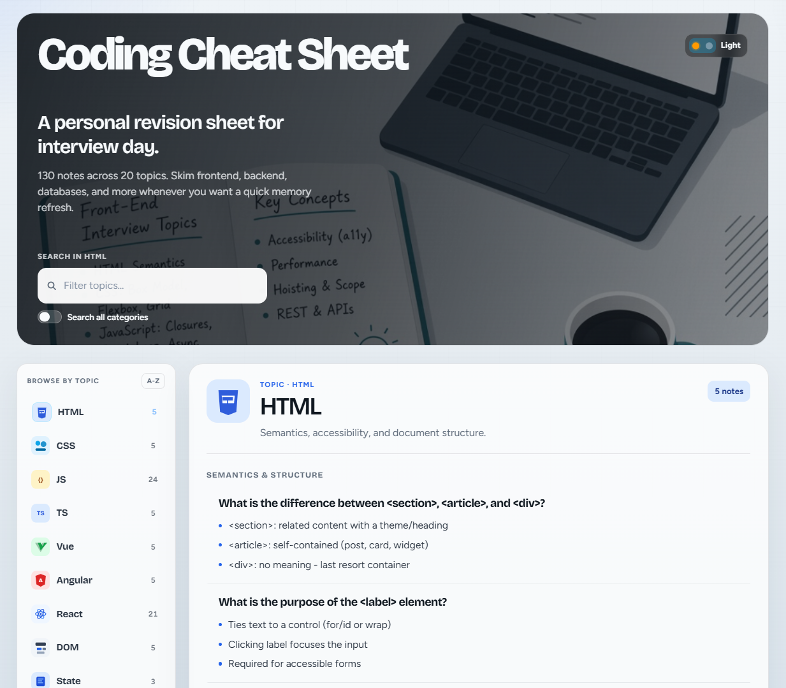
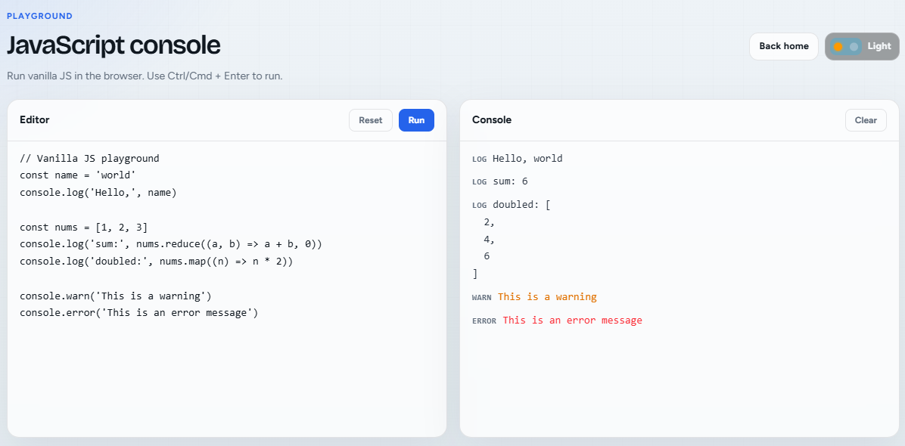

# Coding Cheat Sheet

Personal interview revision site-not a quiz. Skim short notes across frontend, backend, and databases whenever you need a quick refresh.

License: [MIT](LICENSE)





## Stack

- React 19 + TypeScript
- Vite
- Tailwind CSS v4
- Vitest + Testing Library

## Topics

**Frontend:** HTML, CSS, JavaScript, TypeScript, React, Vue, Angular, Browser & DOM, state, performance, network & security, testing

**Backend & fullstack:** Node.js, Express, NestJS, Next.js, Django, Ruby on Rails

**Databases:** MongoDB, PostgreSQL

**Playground:** `/playground` - run vanilla JavaScript in a browser console (link from the home hero).

## Scripts

```bash
npm install
npm run dev       # local app
npm run build     # production build
npm run preview   # preview build
npm test          # unit tests
npm run test:watch
npm run lint
```

## Contributing

Want to add questions? Fork the repo, add your notes, and open a pull request. Helpful contributions are welcome-new prompts, clearer answers, or whole new topics.

## Adding notes

Edit `src/data/questions.ts`.

Structure: **category → topic → questions**, where each question has:

- `question` - prompt text
- `answer` - short bullet lines (`string[]`)
- `difficulty` - `easy` | `medium` | `hard`

Notes sort by difficulty, then A-Z. Add a matching icon in `src/components/TopicVisual.tsx` when you create a new category type.

Keep answers short and skim-friendly (a few bullets each). Run `npm run lint` and `npm test` before you open a PR.
